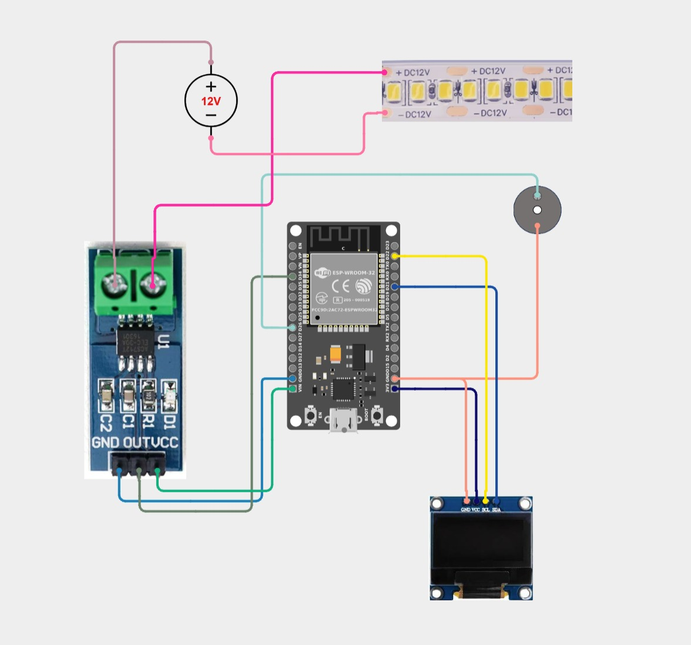
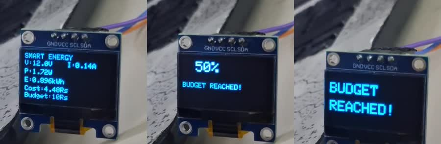
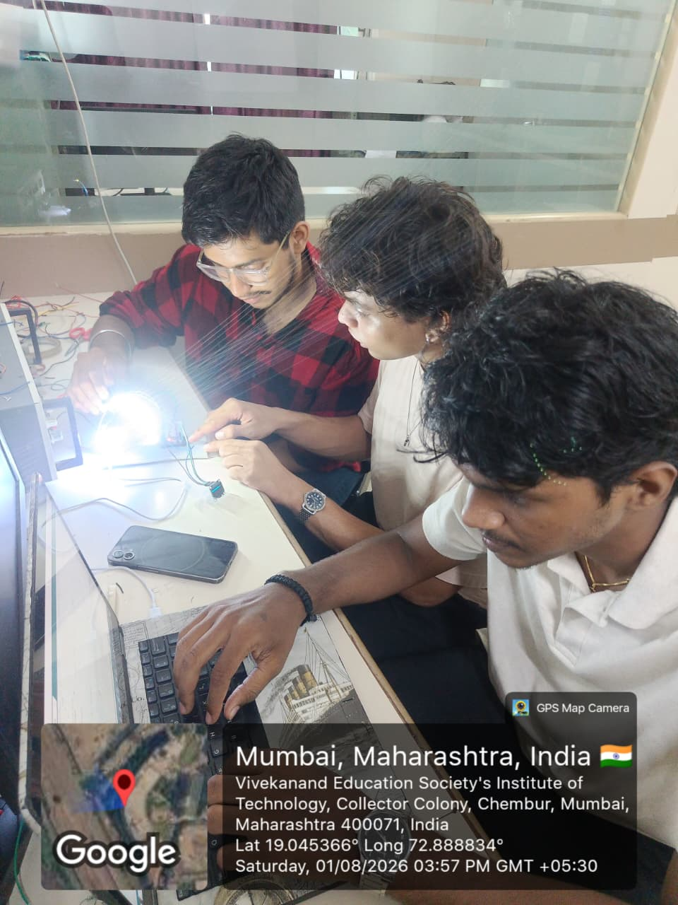
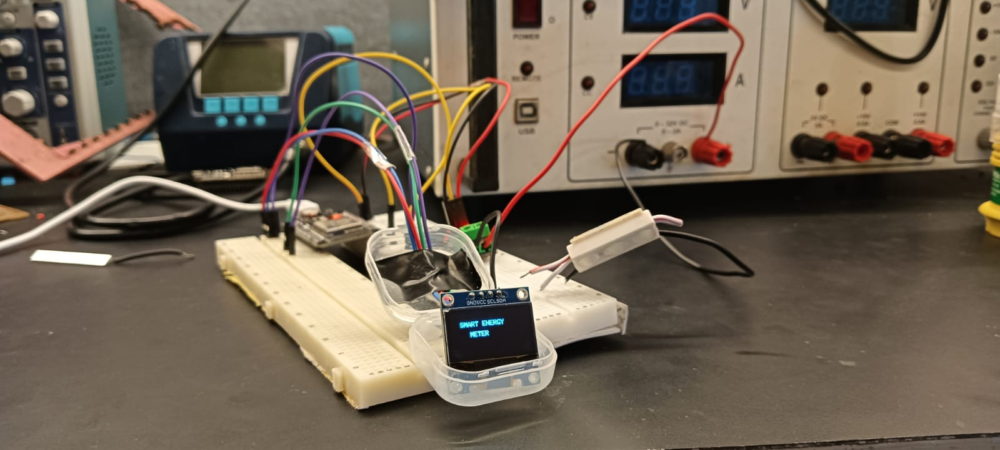
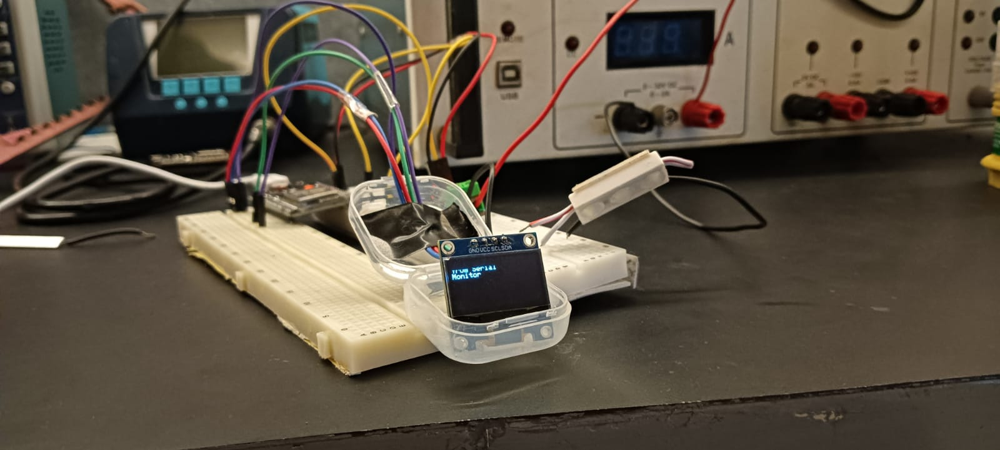
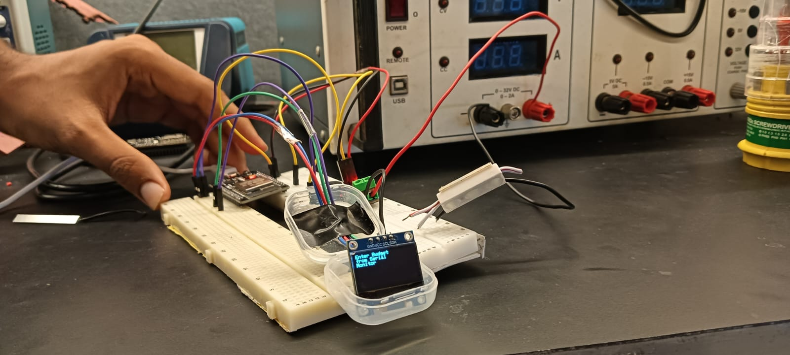
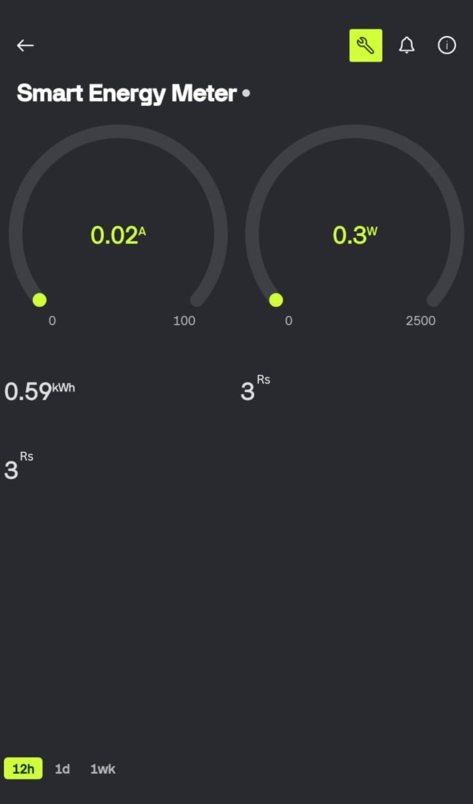

# Smart Energy Meter (ESP32 + ACS712 + Blynk IoT)

An ESP32-based energy meter for a 12 V DC load. It measures load current with an ACS712-5A sensor and calculates power, energy (kWh) and cost (₹). Readings appear on a 0.96" OLED and on a Blynk IoT mobile dashboard. Buzzer alerts trigger when spending reaches 50% and 100% of a user-set budget.

<p align="center">
  
</p>
<p align="center"><em>Demo at 6× speed with a ₹10 budget: live readings → 50% alert → budget reached</em></p>
<p align="center">Full technical report: <a href="docs/Smart_Energy_Meter_Technical_Report.pdf">Smart_Energy_Meter_Technical_Report.pdf</a></p>

---

## Features

- **Current, power, energy and cost** calculated live on the ESP32
- **Calibration at every startup**: a 500-sample zero-offset average, taken with the load off
- **Two-stage budget alerts**
  - 50%: OLED warning plus 3 buzzer beeps (fires once)
  - 100%: `BUDGET REACHED!` plus a continuous 500 ms on/off buzzer
- **Local and remote monitoring**: SSD1306 OLED plus Blynk IoT dashboard (pins V0–V4, updated every 2 s)
- **Accelerated demo mode**: 1 real second = 10 simulated hours, so budget alerts can be shown in a few minutes

## Hardware

| Component | Role |
|---|---|
| ESP32 Dev Board | Controller, calculations, Wi-Fi |
| ACS712 (5A variant, 185 mV/A) | Load current sensing |
| 0.96" SSD1306 OLED (I²C, 128×64) | Local display |
| Buzzer | Budget alerts |
| 12 V LED strips (parallel) | Demo load |
| 12 V DC supply | Load power |
| Breadboard and jumpers | Wiring |

### Pin map

| Signal | ESP32 pin |
|---|---|
| ACS712 OUT | GPIO 34 (ADC, 12-bit, 11 dB attenuation) |
| Buzzer | GPIO 26 |
| OLED SDA | GPIO 21 |
| OLED SCL | GPIO 22 |
| OLED I²C address | 0x3C |

<p align="center"></p>

## How it works

```
12 V supply ──► ACS712 ──► LED load
                  │
                  ▼ analog out
                ESP32 ──► OLED
                  │  └──► Buzzer
                  └──► Wi-Fi ──► Blynk dashboard
```

1. **Calibrate.** At boot, with the load off, the ESP32 averages 500 ADC readings (2 ms apart). The average becomes the zero-current reference `adcOffset`.
2. **Measure.** Each loop averages 100 ADC samples and converts the deviation from the offset into current:

   `I = ((ADC − adcOffset) × 3.3 / 4095) / 0.185`

   Negative values are taken as magnitude, and readings below 0.02 A are treated as 0.
3. **Power.** `P = V × I`, with V taken as the nominal 12 V supply.
4. **Energy.** `E += (P / 1000) × Δt_hours`, where demo mode maps 1 s to 10 h.
5. **Cost.** `Cost = E × ₹5/kWh`, compared against the budget entered on the Serial Monitor.

### Blynk virtual pins

| Pin | Value |
|---|---|
| V0 | Current (A) |
| V1 | Power (W) |
| V2 | Energy (kWh) |
| V3 | Cost (₹) |
| V4 | Budget (₹) |

## Challenges and fixes

| Problem | Cause | Fix | Result |
|---|---|---|---|
| Meter showed current with the load **off** | A hard-coded ACS712 zero offset; the real offset changed between power-ups | Recalculate the offset at every boot (500-sample average, load off) | False zero-load readings largely gone and consistent across restarts |
| Small phantom current (~0.02 A) added up into energy and cost | Sensor and ADC noise around the zero point | 0.02 A software dead-band | Noise no longer adds to energy or cost |
| Budget alerts took far too long to reach in a live demo | A ~1.8 W load uses very little energy | Demo time scale: 1 s = 10 simulated hours | The full 50% → 100% sequence runs in about 2 minutes |

The offset bug took about two days of debugging. It was the main lesson of the project: sensor zero points drift, so they should be calibrated at runtime, not hard-coded.

## Results

Demo run with a ₹10 budget and parallel 12 V LED strips (values from the recording):

| Quantity | Observed |
|---|---|
| Load current | 0.13 – 0.16 A |
| Power | 1.57 – 1.93 W |
| 50% alert | Fired at ≈ ₹5.0 |
| 100% alert | Fired at ₹10.0 (≈ 2.0 kWh simulated) |

**Consistency check:** the run lasted about 110 s of real time, which is about 1,100 simulated hours. At about 1.8 W that gives about 2.0 kWh, matching what the meter accumulated.

<p align="center">
  
</p>

<p align="center"></p>
<p align="center"></p>
<p align="center"></p>
<p align="center"></p>
<p align="center"></p>
<p align="center"></p>

## Limitations

- This is a **12 V DC prototype**, not a mains AC meter.
- Voltage is **assumed** (12 V), not measured, so power is only as accurate as that assumption.
- Readings have not been checked against a calibrated reference meter.
- The ESP32 ADC is not perfectly linear, and the ACS712-5A has coarse resolution at currents around 0.1 A.
- At 100% budget the firmware enters an alert loop. Measurement and Blynk updates stop, and the load is **not** switched off.
- The tariff (₹5/kWh) is fixed in firmware.

## Future work

- Voltage sensing (divider or INA219/INA226) for true power measurement
- Relay or MOSFET load cutoff at 100% budget
- Keep measuring and reporting while the alarm sounds (non-blocking alert)
- Tariff and budget set from the Blynk app
- Energy history logging with daily and weekly charts
- AC version using isolated sensing hardware (PZEM-004T or similar)

## Build and flash

1. Install the **ESP32 board package** in Arduino IDE, plus these libraries: `Adafruit SSD1306`, `Adafruit GFX`, `Blynk`.
2. Copy `firmware/smart_energy_meter/secrets.example.h` to `secrets.h` in the same folder. Fill in your Blynk template ID, auth token and Wi-Fi details. `secrets.h` is git-ignored.
3. Open `firmware/smart_energy_meter/smart_energy_meter.ino` and flash it to the ESP32.
4. Open the Serial Monitor at **115200 baud**. With the load **off**, enter a budget (₹) and wait for calibration to finish, then switch the load on.

## Team

Built in Jul–Aug 2026 at VESIT, Mumbai (Automation & Robotics), under the guidance of **Prof. Kadambari Sharma**.

- Tanishq Shinde
- Ravi Bhatia
- Pratik Rampelli

## License

MIT, see [LICENSE](LICENSE).
